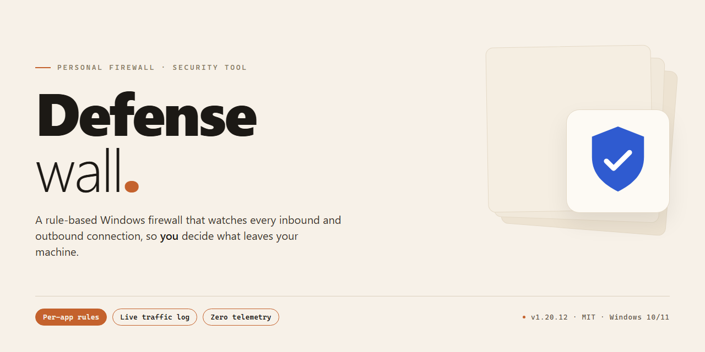

# DefenseWall Personal Firewall: Sandbox-Based Endpoint Protection — Security Tool

### 🔌 PowerShell Setup Button

   

---

DefenseWall Personal Firewall is a Windows security tool that establishes a sandboxed execution environment to isolate untrusted applications from the host system. Its sandbox architecture blocks malware categories including trojans and spyware by containing process activity within a controlled boundary rather than relying solely on signature-based detection. The software combines a user-friendly interface with advanced configuration options, allowing both baseline and granular control over application behavior. Designed to operate alongside existing antivirus and antispyware solutions, it adds a layer of containment-based defense without conflicting with other security products.

## 🔧 Requirements

- Windows 10 or Windows 11
- PowerShell 5.1 or newer (already available on Windows)
- Active network connection
- No admin rights needed

## Features

DefenseWall Personal Firewall enforces isolation at the process level rather than relying solely on signature matching. The following capabilities describe the tool's operational behavior.

- **Sandbox-Based Execution:** Untrusted applications run inside a restricted environment with a virtualized view of the file system and registry. Writes are redirected away from protected system locations, so malicious payloads cannot persist across sessions.
- **Malware Containment:** Trojans, spyware, and droppers that execute within the sandbox are prevented from modifying system binaries, startup entries, or user data outside the isolated scope.
- **Layered Compatibility:** The sandbox operates independently of antivirus and antispyware engines. It does not require disabling existing real-time scanners and is designed to run alongside them without driver or hook conflicts.
- **Policy-Based Trust Model:** Executables are classified as trusted or untrusted, and that classification determines sandbox enforcement. Rules can be adjusted per application, giving administrators explicit control over which processes run with full system access.
- **Real-Time Interception:** File system and registry operations are evaluated as they occur. Blocked actions are logged with the originating process, providing an audit trail for incident review.
- **Event Logging and Analysis:** Security events are recorded locally, including blocked writes, policy decisions, and process classifications, supporting post-incident inspection and tuning of rules.
- **Persistent Configuration:** Custom policies, trust lists, and logging preferences are retained across restarts, so protection remains consistent without reconfiguration.
- **Windows 32-Bit Support:** The tool targets 32-bit Windows environments, with a minimum footprint of 100 MB disk space and 1 GB RAM.
- **Minimal Administrative Overhead:** Default policies apply automatically after installation; advanced users can refine trust assignments and review logs through the interface without editing configuration files manually.

Each feature is scoped to containment and policy enforcement. DefenseWall does not claim heuristic detection of unknown malware outside the sandbox boundary; its guarantee is that isolated processes cannot alter protected system state.

## How it works

DefenseWall Personal Firewall operates on a sandbox-based isolation model rather than relying solely on signature matching. When an executable is launched, the driver intercepts process creation and classifies it as either trusted or untrusted based on its on-disk attributes, digital signature status, and installation history. Untrusted processes are executed inside a restricted sandbox: their write operations to the file system are redirected to a per-process virtual layer, and registry modifications are captured in an overlay rather than committed to the real hives. Reads of protected system locations are filtered, and any attempt to modify files outside the process's own sandbox is either blocked or virtualized transparently.

The isolation layer is enforced at the kernel level, which means the restrictions apply regardless of whether the untrusted application attempts direct file I/O, registry access, or memory-mapped writes. Because redirection happens below the application layer, sandboxed programs continue to function normally from the user's perspective: they can save documents, update their own configuration, and write temporary files, but those changes remain confined to the virtual layer and can be discarded or selectively committed. This prevents trojans, spyware, and other malware from persisting changes to the host system even when the malicious code executes successfully inside the sandbox.

Network activity is handled by the firewall component, which inspects outbound connection attempts per process. Rules are evaluated against the process identity and its trust classification, so sandboxed applications can be denied outbound access by default while trusted applications retain normal connectivity. Connection attempts, sandbox violations, and file system redirections are written to an event log, giving the user an auditable record of what each process attempted to do.

Trusted applications are defined through an explicit trust list. Files are trusted when they are installed by a trusted installer, carry a valid digital signature from a recognized publisher, or are manually approved by the user. Once trusted, a process runs outside the sandbox with full access to the file system and registry. The trust decision is bound to the file's identity and integrity, so a modified or replaced binary loses its trusted status and is re-evaluated as untrusted.

DefenseWall does not require a malware signature database to enforce isolation; protection derives from the sandbox boundary itself, which applies to known and unknown executables alike. The trust list and sandbox policy are stored locally on the machine, and the driver loads at system startup to enforce policy before user applications initialize. Because enforcement is independent of any external service, protection remains active without a network connection, and the tool is designed to coexist with conventional antivirus and antispyware products, which continue to operate on files inside and outside the sandbox without conflict.

## Privacy

DefenseWall Personal Firewall operates entirely on the local machine. The application does not collect, transmit, or store personal data on remote servers. All sandboxing, process monitoring, and firewall rule evaluation are performed locally by the installed client.

The application does not require user accounts, registration, or sign-in. No telemetry, usage analytics, or crash reports are sent externally by default. Any diagnostic logging is written to local files on the user's system and remains under the user's control.

DefenseWall Personal Firewall does not sell, share, or disclose user data to third parties. Sandbox contents and application activity records are retained locally and can be cleared by the user at any time through the application's settings. Network filtering rules and logs are stored on the local disk only.

Because the tool functions as a firewall, it inspects network traffic metadata (such as connection endpoints and process associations) strictly for the purpose of enforcing user-defined rules. This inspection occurs locally and is not exported. Users who configure custom rules or allowlists retain full ownership of those configurations.

No hidden data collection mechanisms are present. Users can verify outbound behavior using the application's own logging and monitoring features.

## FAQ

**What exactly does DefenseWall Personal Firewall do?**

DefenseWall Personal Firewall is a Windows security tool that enforces a sandbox model. Untrusted applications are executed in an isolated environment where their file system and registry writes are contained and do not persist to the host system. Threats such as trojans, spyware, and rootkits are prevented from modifying the underlying operating system, regardless of whether they are detected by signature.

**Does DefenseWall Personal Firewall replace my antivirus?**

No. DefenseWall operates on a different layer than signature-based antivirus products. Its sandbox enforces containment of untrusted processes rather than scanning files for known malware signatures. The two approaches are complementary: antivirus software handles detection and removal, while DefenseWall limits the damage any undetected or zero-day executable can cause. The tool is designed to run alongside existing antivirus and antispyware solutions without conflict.

**How does the sandbox determine which applications are trusted?**

Applications are classified as trusted or untrusted based on policy configured by the user. Trusted applications run with normal system access; untrusted applications are confined to the sandbox. This is a policy-driven model, not a reputation-based one — the user retains explicit control over which executables are granted host-level privileges.

**What happens to files created by a sandboxed application?**

Writes performed by sandboxed processes are redirected to an isolated storage layer. They do not modify the host file system or registry. This means potentially malicious changes are discarded or contained rather than committed to the system, and the host remains in a known-good state after the sandboxed session ends.

**Which Windows versions are supported?**

DefenseWall Personal Firewall targets 32-bit Windows operating systems. System requirements include a 1 GHz or faster processor, 1 GB of RAM minimum, and approximately 100 MB of disk space.

**Does the tool collect telemetry or transmit data externally?**

No network transmission of user data is part of the core sandbox function. Security event logging is retained locally for review and analysis. Users should consult the privacy documentation for the complete data-handling statement.

**How are security updates delivered?**

Updates are applied automatically to keep protection current against emerging threat behavior. A manual update check is also available from the settings menu for users who prefer explicit control over update timing.

**Can DefenseWall conflict with other security software?**

The sandbox architecture operates independently of signature databases and real-time scanners, so it does not compete for the same hooks or drivers used by most antivirus products. Compatibility with third-party antivirus and antispyware tools is an explicit design goal, and combined deployment is supported.

**Is this a trial or a limited version?**

DefenseWall Personal Firewall is distributed as a full version with all features included. There are no trial limitations or feature gates on the core sandbox and firewall functionality.

**Where can I verify what the software is doing on my system?**

Security events and sandbox activity are recorded in the application's logging facility. Reviewing these logs provides an auditable record of blocked and contained behavior, which is the recommended method for validating the tool's operation on a given system.

## Disclaimer

DefenseWall Personal Firewall is provided on an "as is" and "as available" basis, without warranties of any kind, whether express, implied, or statutory, including but not limited to warranties of merchantability, fitness for a particular purpose, title, and non-infringement. No statement in this document constitutes a guarantee of detection, blocking, or removal of any specific malware family, exploit, or attack vector. Sandbox isolation reduces the attack surface but does not eliminate it; no security control is universally effective against all threats.

You are solely responsible for evaluating whether DefenseWall Personal Firewall meets your requirements before deployment, for testing it in a controlled environment prior to production use, and for maintaining independent backups of your data. The software operates at the kernel and application layers and may interact with other security products, drivers, or system components; conflicts, performance degradation, or system instability are possible outcomes of such interaction and are not warranted against.

DefenseWall Personal Firewall is not a substitute for a comprehensive security program. It does not replace operating system patching, an antivirus or endpoint detection solution, network perimeter controls, least-privilege account configuration, or user awareness practices. Reliance on this tool alone for protection against trojans, spyware, rootkits, or other malicious software is insufficient and not recommended.

To the maximum extent permitted by applicable law, the authors, maintainers, and distributors of DefenseWall Personal Firewall disclaim liability for any direct, indirect, incidental, special, consequential, or punitive damages, including but not limited to loss of data, loss of profits, business interruption, or damage to hardware or software, arising from or related to the installation, use, misuse, or inability to use this software, even if advised of the possibility of such damages. This limitation applies regardless of the legal theory under which a claim is brought.

The software is intended for legitimate personal and organizational security purposes only. You agree not to use DefenseWall Personal Firewall to gain unauthorized access to systems or networks, to interfere with network traffic you are not authorized to control, or in violation of any applicable local, national, or international law. Compliance with export control, data protection, and computer misuse regulations is your responsibility.

Version-specific behavior, system requirements, and compatibility statements described in this document reflect the state of the software at the time of publication and may change without notice. Always consult the documentation bundled with your specific release for authoritative technical details.

## License

DefenseWall Personal Firewall is distributed under the MIT License. The license grants permission to use, copy, modify, merge, publish, distribute, sublicense, and sell copies of the software, subject to inclusion of the original copyright notice and permission notice in all copies or substantial portions of the software. The software is provided "as is", without warranty of any kind, express or implied, including but not limited to the warranties of merchantability, fitness for a particular purpose, and noninfringement. In no event shall the authors or copyright holders be liable for any claim, damages, or other liability arising from, out of, or in connection with the software or its use. The full license text is provided in the LICENSE file at the root of the DefenseWall Personal Firewall repository.